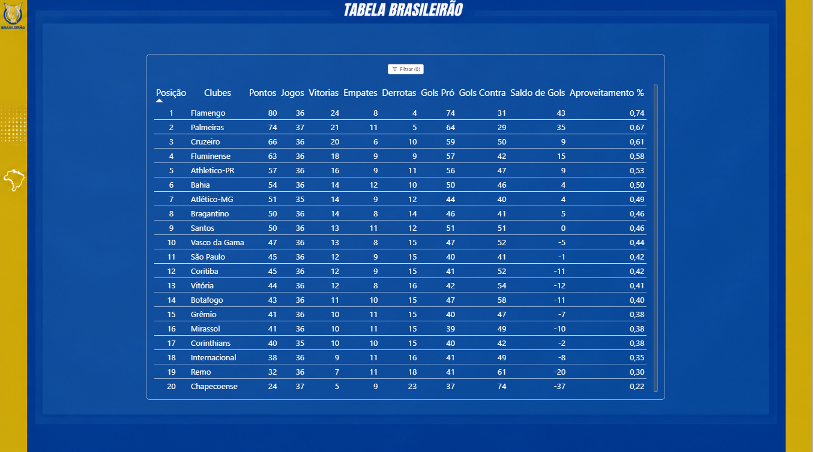
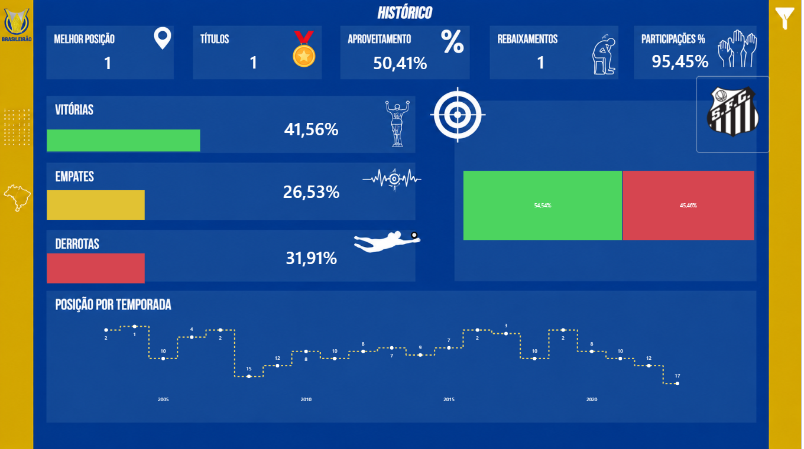

# Brasileirão | Power BI

| Capa | Tabela do campeonato | Histórico |
| --- | --- | --- |
|  |  |  |

Painel interativo do Campeonato Brasileiro feito no Power BI. O relatório reúne a classificação da temporada e indicadores históricos dos clubes em três páginas.

## Páginas do relatório

1. **Capa** — página inicial com acesso à tabela da temporada e ao histórico.
2. **Tabela** — classificação dos clubes, com pontos, jogos, vitórias, empates, derrotas, gols pró e contra, saldo de gols e aproveitamento.
3. **Histórico** — indicadores históricos do clube, como melhor posição, títulos, aproveitamento, rebaixamentos, participações, resultados e posição por temporada.

## Filtro de clube

Na página de histórico, clique no ícone de funil no canto superior direito para acessar os filtros e selecione o clube que deseja analisar. Os indicadores e gráficos configurados para interagir com o filtro passam a mostrar os dados do clube selecionado. Limpe a seleção para voltar à visão geral.

## Como funciona

O arquivo `.pbix` reúne o modelo de dados, as páginas do relatório, os visuais e as medidas. O Power BI relaciona os dados usados pelas visualizações e recalcula os indicadores quando um filtro é aplicado.

1. Abra `Tabela Brasileirao.pbix` no Power BI Desktop.
2. Se o Power BI solicitar os visuais personalizados, importe os arquivos `.pbiviz` listados abaixo em **Visualizações > Importar um visual de um arquivo**.
3. Use as páginas e o filtro de clube para explorar a classificação e o histórico.
4. Para atualizar os dados, use **Página Inicial > Atualizar** no Power BI Desktop. A atualização depende de as fontes configuradas no relatório estarem acessíveis.

## Visuais personalizados

Os arquivos dos visuais estão em `libs/extensions/`:

- `ChicletSlicer.pbiviz` — **ChicletSlicer 2.2.3.0**, visual personalizado de segmentação.
- `SimpleImage.pbiviz` — **Simple Image 1.0.2**, visual personalizado para exibição de imagens.

## Arquivos do projeto

- `Tabela Brasileirao.pbix` — relatório e modelo do Power BI.
- `data/brasileirao.csv` — arquivo de dados do Brasileirão.
- `data/links_diretos_44_times_com_siglas.xlsx` — planilha de links e siglas dos times.
- `libs/result/` — imagens das três páginas incluídas acima.
- `libs/backgrounds/` — imagens de fundo usadas como recursos visuais.
- `libs/extensions/` — visuais personalizados do Power BI.

## Requisitos

- Power BI Desktop para Windows.
